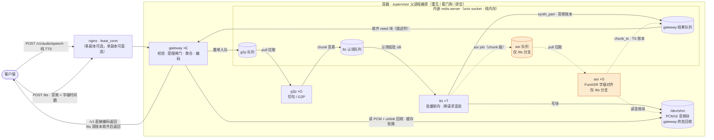
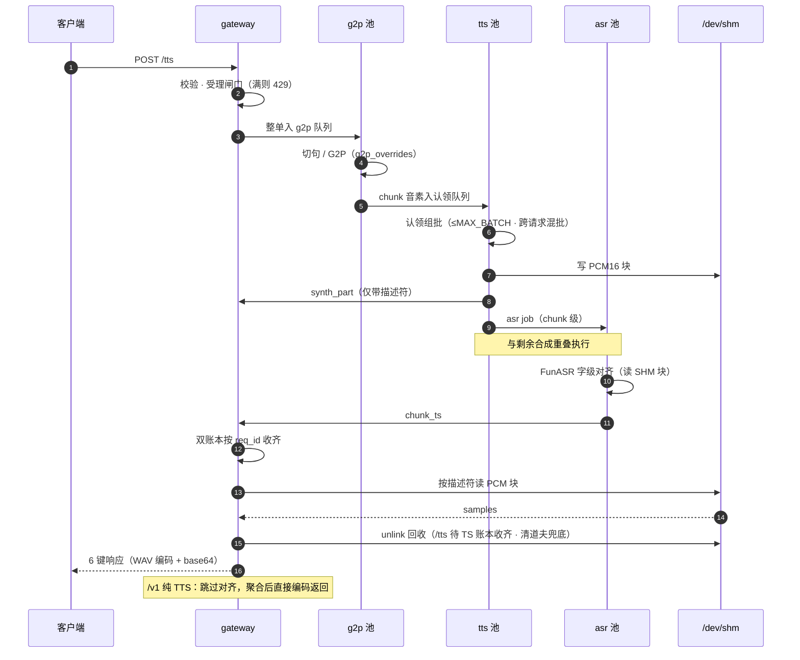
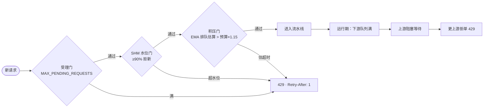
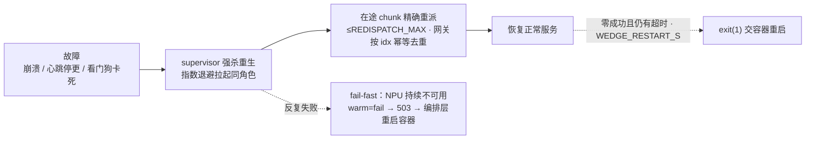

# kokoro-tts-ascend

Kokoro TTS（`hexgrad/Kokoro-82M-v1.1-zh`，103 中文音色 + 中英混合）的
**昇腾 Atlas 800T A2 / 910B 容器镜像**：

- `POST /v1/audio/speech` —— OpenAI 兼容，音频流（纯 TTS）
- `POST /tts` —— 业务接口：`audio_base64` + FunASR 字级时间戳

## 架构

### 进程拓扑



两条请求**共享主干** gateway → g2p → tts（跨请求混批，同批可混 /v1 与 /tts 的
chunk）；**分叉点两处**——① tts 前向后仅对 /tts 的 chunk 派 asr job（图中橙色
虚线分支）；② 聚合后 /v1 直接编码返回，/tts 还要等 TS 账本收齐（时序图见下）。
返回前网关按**描述符**从 SHM 读出 PCM 编码 base64 并 unlink 回收块（/tts 延迟到
TS 账本收齐，孤儿由清道夫兜底）——消息只走描述符、音频零拷贝走 SHM、网关终态
回收，即 /dev/shm 缓存的轮换机制。

并发模型：同类 worker 无状态，从共享队列取活；tts/asr 原子凑批（同长度档
≤8 句一次前向）+ 认领登记（挂掉精确重派）。队列全部有界，逐级背压，最终
拒单 429。队列走 Redis（supervisor 托管，unix socket、纯内存）。
**pull 模式**——worker 空闲即取（LPOP 轮询，无预分配无队头阻塞）；消息常驻服务端，
队列内消息零丢失（已认领未 ack 的由 supervisor 按 worker 死亡精确重派，秒级；
TTL 只兜漏检极端）。depth = LLEN/ZCARD = 真实等待数。gateway 进程间以 SO_REUSEPORT
均匀分接连接。设计要点：聚合在网关（compute 无状态可混批）；`protocol.py` 为消息契约
单一事实来源。

### 请求时序（/tts）



### 背压与拒单



拒绝原因由响应头 `X-Reject-Reason` 机器可读区分（`queue_full` / `shm_pressure` /
`wait_budget`），细节见下方 429 章节。

### 自愈闭环



redis-server 死亡 → supervisor 自动重启（队列重置，在途请求走超时兜底）；
客户端断连逐级取消任务（CANCEL 下发，已派发批算完即弃）。

## 代码结构（根目录平铺，按职责分文件）

| 模块 | 职责 |
|---|---|
| `supervisor.py` | 容器入口父进程：spawn 四类 worker 池 + 内嵌 redis + 看门狗 |
| `gateway.py` | FastAPI 入口进程：`/v1/audio/speech` 与 `/tts` 端点、`_synth` 主干、引导 |
| `gateway_state.py` | 网关全部可变状态与可配常量（测试经它 patch；内部一律 `gst._X` 访问） |
| `gateway_agg.py` | 聚合引擎：结果泵 + synth_part/chunk_ts 账本 + SHM 块生命周期 |
| `gateway_obs.py` | 观测面：心跳/僵尸清理、/health 聚合、Prometheus 指标数据面 |
| `audio_enc.py` | WAV/FLAC/PCM/ffmpeg 编码 + chunk 拼接 |
| `g2p.py` | g2p 池 worker：切句/音素化/chunk 发布 |
| `compute.py` | tts/asr 池入口 facade（`tts_main`/`asr_main`，供 supervisor spawn） |
| `tts_worker.py` / `asr_worker.py` | 两个推理角色的实际实现 |
| `worker_common.py` | 两角色共享：看门狗/stats 账本/快照骨架/NPU 采样/回投壳 |
| `pipeline.py` | 文本引擎（G2PEngine）与计算引擎（TTSCompute）+ 单例 |
| `npu_ops.py` | NPU 运维层：npu-smi 解析、设备发现、显存预算/估算 |
| `batched_model.py` | KModel 批前向数学（padding 等价性 + 卡上量化） |
| `funasr_ts.py` | FunASR 词级时间戳封装（批推安全补丁/切组/字符绑定） |
| `protocol.py` | 跨进程消息契约（唯一事实来源） |
| `proc_common.py` | 公共件 facade：配置/传输/心跳三层 + BusyWatch/retry_forever/shm_usage |
| `config.py` | `TUNABLE_PARAMS` 注册表（env 默认值单一来源）+ env 解析 + 日志初始化 |
| `redis_transport.py` | redis-server 自举、普通/认领两队列、取消标记 |
| `heartbeat.py` | worker 心跳原子落盘线程 |

约定：跨模块引用可变状态一律经所属模块属性（如 `gateway_state as gst` →
`gst._pending`）——测试的 monkeypatch 目标即定义模块。`compute.py` 与
`proc_common.py` 只做聚合再导出（`proc_common` 另保留 BusyWatch/
retry_forever/shm_usage 三个进程级小件）；`gateway.py` 保留 app/端点/
`_synth` 主干，并再导出两个异常类供测试沿用。

## 构建

镜像内预置权重 + 103 音色（构建走 hf-mirror，运行期完全离线）。
`wheels/` 内的 en_core_web_sm 官方 wheel 已入库（构建期不连 GitHub；
更新方法见 Dockerfile 内注释）。

```bash
TAG=$(date +%Y%m%d)
docker build --platform linux/arm64 --build-arg IMAGE_VERSION=$TAG \
  -t kokoro-tts-ascend:$TAG -t kokoro-tts-ascend:latest .
```

## 运行

前置：aarch64 + 驱动满足 CANN 9.2 配套（`npu-smi info`、`ls /usr/local/Ascend/driver`）。

```bash
docker run -d --name kokoro-tts \
  --restart unless-stopped \
  --shm-size 2g \
  --log-opt max-size=50m --log-opt max-file=3 \
  -p 5174:5174 \
  -e TTS_WORKERS=4 -e GATEWAY_WORKERS=2 -e ASCEND_DEVICE_ID=0 \
  --device /dev/davinci0 --device /dev/davinci_manager \
  --device /dev/devmm_svm --device /dev/hisi_hdc \
  -v /usr/local/Ascend/driver:/usr/local/Ascend/driver:ro \
  -v /usr/local/dcmi:/usr/local/dcmi:ro \
  -v /usr/local/bin/npu-smi:/usr/local/bin/npu-smi \
  kokoro-tts-ascend:$TAG
```

> **`--shm-size` 必须带（≥2g）**：音频以 PCM16 写 `/dev/shm`（较 float32 减半）直到聚合
> 完成；docker 默认 64MB 会被长文本 /tts 写满触发 **SIGBUS**（症状：/v1 正常、/tts 全崩
> rc=-7）。启动自检 <1GB 打 ERROR，运行期水位 ≥80% 告警、≥90% 拒新请求
> （429 `shm_pressure`；/health `shm` 字段可见），暴死的半成品块由清道夫
> 超龄自动回收。`--log-opt`：TEXT 全文记录后日志必须轮转防盘满。

装了 ascend-docker-runtime 可简化为：`docker run -d --shm-size 2g --runtime ascend -e ASCEND_VISIBLE_DEVICES=0 -p 5174:5174 kokoro-tts-ascend:$TAG`。

多容器 + nginx：`IMAGE_TAG=$TAG docker compose up -d --build --scale api=4`（扩容后 `docker compose restart nginx`）。
> `--scale` 每副本默认 4 tts × B8 + 4 asr × B8（64GB 整卡 ≈55GB 物理占用）——**单卡只能 1 副本**；多副本需多卡并在 compose 里按卡调小 worker 数。

> **升级语义**：队列 member = 2B 音素数 + 1B 精度 + 20B 序号 + 载荷，格式
> 不跨版本兼容。生产按"整体替换容器"升级（队列随容器内 redis 消亡，天然满足）；
> 若用 `IPC_REDIS_URL` 接外部共享 Redis：先停 gateway 与 g2p（不再产生新请求）
> → 等 `/metrics` 的 `tts` depth=0（旧 worker 吃完队列）→ 停旧 tts/asr →
> 起新版本，排空后不存在混合格式 member。

> **外部共享 Redis 限制**：队列键与 gateway 结果队列按本实例 origin 编号，
> supervisor 的 sweep 只认本进程拉起的 worker pid——**一个 Redis 只允许
> 一个 supervisor/副本**。多副本共享同一 Redis 需要实例 ID 命名空间 +
> 存活 worker 注册表，当前未实现；多副本请每副本各自内嵌 Redis。

验证：

```bash
curl -s http://127.0.0.1:5174/health | jq '{status, ready, shm}'
curl -s http://127.0.0.1:5174/v1/audio/speech -H 'Content-Type: application/json' \
  -d '{"model":"kokoro-v1.1-zh","input":"你好，欢迎使用昇腾算力。","voice":"zf_001"}' -o out.wav
```

## 压测与调参

吞吐 ≈ `TTS_WORKERS × TTS_MAX_BATCH_SIZE`（ASR 池需保有 ≥0.3× 该值的吞吐单位，
q_asr 排队 EMA 上来就 `ASR_WORKERS`+1 或 `ASR_MAX_BATCH_SIZE`+，线性模型上线前
以 bench 实测验证），90% 情况只调这几个参数：

| 现象 | 动作 |
|---|---|
| req/s 线性涨、`B=` 打满上限 | `TTS_MAX_BATCH_SIZE` 8→12~16（显存预算随 B 自动缩放，memcalc 核算） |
| 批打满但 NPU 利用率低、p95 尚可 | `TTS_WORKERS` +1 |
| p95 恶化但 req/s 还在涨 | 拐点，回退一档收敛 |
| realtime 不涨、p95 恶化 | NPU 饱和，停手 |
| ASR chunk 行 `queue_ms` 持续走高（或 `/metrics` 的 `queue_avg_wait_ms{stage=asr}`） | `ASR_WORKERS`+1（B8 每 worker 预算 ~2.7GB / npu-smi ~3.1GB）或 `ASR_MAX_BATCH_SIZE` 上调 |

```bash
# 随机长短混合文本（必须：固定文本会命中 g2p 缓存虚高）
docker exec kokoro-tts python /opt/benchmark.py \
  --url http://127.0.0.1:5174 --endpoint tts -c 1,2,4,8 -n 32 --random 50
```

显存核算（两池共居 + 吞吐档参考）：`python scripts/memcalc.py --max-batch <B> --card-gb <容量> --workers <N> --asr-workers <N>`；
`python scripts/memcalc.py --profiles` 打印 64GB 卡吞吐档表（旧基线 6×B4=24u ~36GB →
现行默认 4×B8（tts 32u）+4×B8（asr 32u）~55GB → 均衡档 6×B6+4×B4
（tts 36u/asr 16u）~58GB；4×B12+2×B10=48u 按 1.05×预算+ctx 新核算约 67GB，
64GB 卡已超，不再作为默认候选。

## 测试

```bash
python -m pytest tests/ -q                                            # 离线全套（无模型依赖）
docker exec <容器> python -m pytest tests/ -q                          # 镜像内同套
# 真实 Redis 用例（tests/test_claim_integration.py / test_ipc_crashsafe.py）
# 会在 6399 端口自起 redis-server；Windows 无该二进制时自动 skip，离线
# fakeredis 用例仍覆盖 ack/毒块路径。
docker exec -e RUN_LIVE_SMOKE=1 <容器> python -m pytest tests/test_tts_api.py -v   # 真机冒烟
HF_HOME=.hf-cache DEVICE=cpu python tests/validate_batch.py           # 批量一致性数值门（需权重）
python tests/validate_asr_batch.py                                    # asr 批推数值门：自动选设备（有 NPU 上卡，无卡 CPU）；B 默认取 ASR_MAX_BATCH_SIZE，可传参覆盖；独立进程会额外占卡
docker exec <容器> python tests/validate_asr_batch.py                  # docker exec 不走 ENTRYPOINT：脚本自动经 scripts/with_ascend_env.sh 重入加载 CANN；FUNASR_DEVICE=cpu 可强制 CPU
RUN_REAL_FORWARD=1 HF_HOME=/opt/hf-cache python -m pytest tests/test_real_forward.py -v
python scripts/parity_smoke.py                          # 故障注入冒烟（多网关/断连/杀 tts 重派；需先按脚本头启动服务）
# RUN_REAL_FORWARD 行为真实前向回归（CPU，~60s；覆盖 batched_model——
# 生产事故都出在这个无 mock 覆盖的路径）
```

## CPU 端到端验证（x86 Docker，无需 NPU）

生产镜像为 arm64 Ascend 基底，x86 QEMU 下 `import torch` 会段错误，不能作为 CPU
运行载体。CPU 验证走独立的 `Dockerfile.cpu`（原生 x86 + CPU torch），模型资产
从现有 arm64 镜像提取后只读挂载（`docker cp` 不执行镜像代码）：

```bash
# 0) 前置：WSL Docker 可用；本机已有 kokoro-tts-ascend 镜像（或桌面 .tar.gz）
bash scripts/extract_cpu_assets.sh                       # 默认 --image kokoro-tts-ascend:latest
#    缺镜像但有导出包：bash scripts/extract_cpu_assets.sh --tar /mnt/c/.../kokoro-tts-ascend-YYYYMMDD.tar.gz

# 1) 构建 CPU 镜像（torch CPU 轮子约 2-3GB；源不可达可 --build-arg PYTHON_IMAGE=pytorch/pytorch:2.15.0-cpu）
docker build -f Dockerfile.cpu -t kokoro-tts-cpu:local .

# 2) 全量验证（构建 + 镜像内 pytest + 真实模型功能/数值门 + 故障注入）
python3 scripts/cpu_e2e.py --assets cpu-e2e-assets
#    分阶段：--phases baseline,numeric / --skip-build / --keep

# 3) 深度行为/故障/配置矩阵（编码全格式+ffprobe、音色/语速/覆盖/精度、
#    真实批宽、CORS/keep-alive、kill gw/asr/g2p/tts、stale 击杀、wedge、
#    metrics off / EN off/espeak / 语速下限 / body 上限 / 全局词典 / 外部 Redis）
python3 scripts/cpu_e2e_deep.py --skip-build --assets cpu-e2e-assets
```

### NPU/ARM 发布前预检

CPU 验证不能替代 arm64/NPU 路径。以下脚本构建**生产 arm64 镜像**并在 QEMU
下完成可验证的部分（模块清单/compileall/import/pytest 子集/依赖版本/模型
烘入/NPU 预算锚点/采样率守卫），并记录 QEMU 下 torch 是否可导入：

```bash
python3 scripts/npu_prep.py                 # 构建 + 预检（不导出 tar）
python3 scripts/npu_prep.py --skip-build    # 复用已有 arm64 镜像
```

注意：QEMU 下 torch 常因 oneDNN/xbyak 段错误不可用（脚本只记录、不门控）；
NPU 算子、真机显存预算与吞吐必须在 Ascend 主机上用同一镜像再跑一次
`docker run -e DEVICE=npu ...` / `scripts/npu_probe_check.py` 验证。

`scripts/cpu_e2e.py` 的 gate：

| 阶段 | 内容 |
|---|---|
| `build` | 构建 CPU 镜像；`import torch/kokoro/funasr` 冒烟 |
| `pytest` | 镜像内 `pytest tests/ -q -rs`；只允许 7 个环境门控 skip（5 live smoke + 2 real forward），真实 redis 用例必须执行 |
| `baseline` | 真实模型起 supervisor：`/health` starting→ok、双端点、WAV/PCM/FLAC/MP3、多批 `X-Batch-Size>1`、`/tts` 字级时间戳（段数=可对齐字符数）、`check_align --strict`、`test_tts_api.py`、`verify_boundaries.py` |
| `numeric` | `validate_batch.py`、`validate_asr_batch.py`、`RUN_REAL_FORWARD=1 test_real_forward.py` |
| `fault` | `parity_smoke.py`（多网关/断连/杀 tts 重派）、SO_REUSEPORT 双进程分流、kill 内嵌 redis 自愈、ASR 未就绪 503→恢复、SHM 孤儿清扫、优雅退出、429×3（queue_full/wait_budget/shm_pressure）、504、499 |
| `report` | `artifacts/cpu-e2e-<ts>/summary.{json,md}` + 日志/指标/tts.json/pytest.xml |

CPU 模式关键 env（驱动已内置）：`DEVICE=cpu`、`FUNASR_DEVICE=cpu`、
`ASR_MAX_BATCH_SIZE=1`（缩短 30s×B 热身）、`SPAWN_READY_TIMEOUT_S=0`、
`STUCK_KILL_S=1800`（CPU 加载慢）、`WEDGE_RESTART_S=0`（故障注入期间不退出）。
预期耗时：构建 5-15 分钟，完整 E2E 30-60 分钟。模型资产与 `artifacts/` 已在
`.gitignore`/`.dockerignore` 中排除。若 CPU torch 源不可达，构建日志会给出
fallback 基底；模型资产缺失时 `extract_cpu_assets.sh` 会明确报错。

## 配置（启动时全部打印实际值，清单单一来源 `proc_common.TUNABLE_PARAMS`）

| 变量 | 默认 | 说明 |
|---|---|---|
| `TTS_WORKERS` | 4 | 前向进程数，单卡吞吐主参数（每进程独立显存预算；64GB 卡默认 4×B8，32GB 卡建议 2） |
| `TTS_MAX_BATCH_SIZE` | 8 | 单批最大句数，**决定显存峰值与预算**（B=8/120字/0.5速 ≈ 9.3GB/worker 预算；64GB 卡默认整卡 ~55GB 物理含 asr 池） |
| `ASR_WORKERS` | 4 | asr 对齐进程数（唯一 FunASR 池，/tts 依赖）。默认 4×B8=32u，与 tts 4×B8=32u 对等；q_asr 排队 EMA 调节——走高 +1（B8 每 worker 预算 ~2.7GB / npu-smi ~3.1GB），持续走低可回落 3 |
| `ASR_MAX_BATCH_SIZE` | 8 | asr 单批认领上限，**决定 asr 显存预算**（pipeline 公式随它缩放：B=8 ≈ 2.7GB/worker；启动期最坏形状热身实测校验，OOM 阶梯自降批宽不 fail worker） |
| `GATEWAY_WORKERS` / `G2P_WORKERS` | 2/2 | 各池进程数；全部**最少 1**（0/负数钳 1 并告警） |
| `MAX_INFLIGHT_SENTENCES` | 512 | 认领队列容量（在途句数闸门）：满则 g2p 阻塞 → 上游 429；worker 死亡其在途立即精确重派（≤REDISPATCH_MAX 次，超限放弃 504 兜底） |
| `MAX_PENDING_REQUESTS` | 200 | 受理级闸门，满则立即 429（Redis 容量门为 LLEN 判满，并发生产者下超卖 ≤ 生产者数、随消费自愈，方向安全） |
| `WORKER_MAILBOX_SIZE` | 1024 | 各级队列容量（含 ack；满则背压逐级传导） |
| `WAIT_TIMEOUT_S` | 120 | **单请求总预算**（秒）：音频+对齐共享同一截止线（不再是两段各 120s 串联），超时 504 并下发 CANCEL（在途 chunk 前向前被丢弃） |
| `FAST_REJECT_MARGIN` | 1.15 | 准入快速拒绝冗余系数：路径各段 EMA 排队等待求和 > WAIT_TIMEOUT_S×系数 才秒拒 429（EMA 是估计值，边界放行） |
| `TTS_MAX_INPUT_CHARS` / `TTS_CHUNK_CHARS` | 2000/120 | 输入上限（不影响显存峰值，影响队列压力）/ 切句长度（不建议调小；实际单 chunk 上限还会被 `_chunk_cap` 的 `int(128×speed)` 钳住，调高到 128 以上在 speed=1 时不再生效——这是 ASR 组 ≤30s 的保证） |
| `TTS_SPEED_FLOOR` | 0.5 | 语速钳制下限，**进入显存预算公式**（帧数 ∝ 1/speed） |
| `TTS_BATCH_BUCKET_CHARS` | 64 | 认领类宽（音素长度 // 该值 相同的 chunk 才同批；无攒批定时窗） |
| `G2P_CACHE_SIZE` | 4096 | 句子级 LRU 缓存（0=关闭）；压测须用 `--random` 打穿 |
| `METRICS_ENABLED` | 1 | `/metrics` 开关（0=关闭返回 404） |
| `MAX_BODY_BYTES` | 4194304 | 请求体上限（超出 413；对外暴露时的基本防线） |
| `SHM_ORPHAN_MAX_AGE_S` | 300 | 无主音频 SHM 块回收线（自动取 max(本值, 2×WAIT_TIMEOUT_S+60)，防误删活块） |
| `REDISPATCH_MAX` | 1 | 同一 chunk 重派次数上限（毒块防护；超限放弃，受影响请求 504 兜底） |
| `IPC_REDIS_SOCKET` | /tmp/kokoro-redis.sock | 队列服务端 unix socket（supervisor 拉起的 redis-server，纯内存有界） |
| `WEDGE_RESTART_S` | 900 | 端到端假死判死：全角色就绪后连续该时长零成功且仍有超时 → `exit(1)` 交容器重启（0=禁用） |
| `G2P_THREADS` | =G2P_WORKERS | 每 g2p 进程的线程池大小（与进程数是两个维度） |
| `STUCK_KILL_S` | 300 | 看门狗击杀线（busy 覆盖计算段与 NPU 初始化段——设备探测/模型加载/冒烟挂死同样会被击杀重生；背压阻塞不算卡死） |
| `SPAWN_READY_TIMEOUT_S` | 360 | NPU 角色串行启动就绪等待；0=并行（旧行为） |
| `FFMPEG_TIMEOUT_S` | 30 | mp3/opus/aac 编码子进程超时 |
| `HEARTBEAT_STALE_S` | 30 | 心跳停更判 hang 阈值 |
| `KEEP_ALIVE_TIMEOUT_S` | 0 | keep-alive 超时（0=逐请求 accept，多入口均衡需要） |
| `DEVICE` / `ASCEND_DEVICE_ID` / `FUNASR_DEVICE` / `FUNASR_INPUT` | 空/空/auto/auto | 强制设备 / 卡号（容器内逻辑号）/ FunASR 设备 / 推理输入通道 |
| `KOKORO_MODEL_ID` / `KOKORO_SAMPLE_RATE` / `KOKORO_VOICE` | hexgrad/Kokoro-82M-v1.1-zh / 24000 / zf_001 | 模型身份（勿随意改；采样率非 24000 启动即报错） |
| `KOKORO_EN_G2P` / `KOKORO_DISABLE_COMPLEX` | auto | 英文 G2P / NPU 纯 conv STFT |
| `KOKORO_G2P_DICT` | 空 | 全局多音字词典：文件路径（ConfigMap 挂载）或内联内容；格式"词组 拼音1 拼音2…"（TONE3 带调），分号/换行分隔。内置 长文本/很长/太长 等 10 条 |
| `PORT` / `IMAGE_VERSION` / `LOG_LEVEL` | 5174/dev/INFO | 端口 / 版本（构建期注入）/ 日志级别（请求文本 INFO 打完整单行） |
| `HF_HUB_OFFLINE` | 1 | 镜像属性，运行期勿调（永不触网） |

### 升级注意（v6 之后）

- **默认配置改为 tts/asr 均衡**：`TTS_MAX_BATCH_SIZE` 4→8、`TTS_WORKERS` 6→4、
  `ASR_WORKERS` 3→4、`ASR_MAX_BATCH_SIZE` 4→8。64GB 整卡默认约 55GB 物理占用；
  旧部署若沿用 5 tts + 4 asr B4，真机实测约 62.4GB（95%），升级前用
  `scripts/memcalc.py --workers N --asr-workers N` 核对 env，或显式钉住每个值
  （`k8s-deploy.yaml` 已钉）。
- **/tts 最坏时延变短**：音频+对齐共享一个 `WAIT_TIMEOUT_S` 截止线（不再是两段各 120s
  串联）；依赖旧 2×WAIT 上限的长文本客户端会提前收到 504。
- **funasr 钉 1.4.21**：批推数值安全补丁依赖其内部结构；升级 funasr 前必须重跑
  `tests/validate_asr_batch.py`，并确认心跳 stats 的 `batch_patch_ok=true`（否则运行
  时自动降回单条路径，吞吐降级但时间戳不会漂移）。

## API

| 方法 | 路径 | 说明 |
|---|---|---|
| POST | `/v1/audio/speech` | OpenAI 兼容。`response_format`: wav/pcm/mp3/flac/opus/aac；纯 TTS |
| POST | `/tts` | 请求体 `{"text","speed"(下限 0.5 钳制；>4 拒绝 422),"voice"}` → 响应恰好 6 键 `{"code":0,"audio_base64","duration","message","text","timestamp":[[起ms,止ms],...]}`（g2p 兼容别名已移除，精简 6 键契约）；请求不带 Content-Type 或 urlencoded 亦可（网关归一为 JSON）；业务错误 `{"error":...}`，Pydantic 参数校验失败（如 speed>4/类型错）为 422 `{"detail":...}` |
| GET | `/v1/voices` `/v1/models` | 音色（103）/ 模型列表 |
| GET | `/health` | 精简结论卡：`status`/`ready`/`version`/`shm`/`recent_failures`；**未就绪返回 503**（readiness 语义），完整数值走 `/metrics`，探针见 K8s 章节 |

响应头：两个端点都返回 `X-Request-ID`（12 位，与全部 worker 日志 `req=` 一致，报障一行 grep 全链路）；`/v1/audio/speech` 另返回 `X-Audio-Duration`、`X-Synth-Time`、`X-Batch-Size`。客户端断开 → 请求取消（499，CANCEL 逐级下发，已派发批照常算完但结果丢弃）。

### 日志（请求关联三级键 req/bid/chunk）

日志按「谁 / 何时 / 为谁 / 干了什么」设计：行首 `[wtag]` 说明发出者，每行带绝对时间戳，`req/bid/chunk` 三级关联键把一次请求的全部行串起来。

```text
[g2p-0] 2026-11-15 09:05:12,331 INFO:kokoro.g2p-0:req=8e0c68e5 queue_ms=8.1 process_ms=12.4 chunks=6 ovr=0 chars=651 sents=2
[tts-0] 2026-11-15 09:05:13,102 INFO:kokoro.tts-0:bid=t0-12345-42 n=3 process_ms=502.1 audio_s=34.8 dt=fp32
[tts-0] 2026-11-15 09:05:13,102 INFO:kokoro.tts-0:chunk=8e0c68e5_4_0 bid=t0-12345-42 process_ms=502.1 queue_ms=1800 audio_s=11.6 chars=108 sents=2
[asr-0] 2026-11-15 09:05:13,340 INFO:kokoro.asr-0:bid=a0-12345-17 n=3 process_ms=890.2
[asr-0] 2026-11-15 09:05:13,340 INFO:kokoro.asr-0:chunk=8e0c68e5_4_0 bid=a0-12345-17 process_ms=890.2 queue_ms=120 chars=25
[gw-1] 2026-11-15 09:05:17,980 INFO:kokoro.server:ep=/tts req=8e0c68e5 voice=zf_001 speed=1.00 audio_s=136.1 e2e_s=5.85 agg_ms=4 enc_ms=83
[gw-1] 2026-11-15 09:05:17,991 INFO:kokoro.server:req=8e0c68e5 chars=651 text=…
```

**三级关联键**

| 键 | 级别 | 出现在 | 用途 |
|---|---|---|---|
| `req` | 请求 | g2p 行 / done 行 / text 行 | `grep <req_id>` 串起一次请求的全旅程（也是响应头 X-Request-ID） |
| `bid` | 批 | TTS/ASR 头行 + chunk 行 | `grep <bid>` 看一次认领批/推理批的构成（bid = `<t|a><worker>-<pid>-<批序号>`——t=TTS/a=ASR；嵌 pid：worker 重启后批序号归零也不重复） |
| `chunk` | 块 | TTS chunk 行 + ASR chunk 行（同值） | `grep chunk=<rid>` 对齐同一块音频的合成段与对齐段（= `{req_id}_{need}_{idx}`） |

**字段命名规范**：时长 = `<语义>_<单位>`（`queue_ms/process_ms/qmax_ms/e2e_s/audio_s/agg_ms/enc_ms`）；计数 = 无后缀（`chunks/sents/chars/words/n/ovr`）；动词短语不出现（`[wtag]` 已表达身份）；失败 = WARNING/ERROR 级 + 归属 + 原因文本。

**逐行口径**

| 行 | 粒度 | 字段 |
|---|---|---|
| `req= queue_ms= process_ms=`（g2p） | 1/请求 | queue_ms=原始请求在 g2p 队列的等待；process_ms=切句+音素；chunks=拆分块数；chars/sents=整单字数/句数；ovr=多音字覆盖数 |
| `bid= n= process_ms= audio_s= dt=`（TTS 头） | 1/前向批 | n=批内 chunk 数；process_ms=前向墙钟；audio_s=Σ 有效产出；dt=本批精度 |
| `chunk= bid= queue_ms= audio_s= chars= sents=`（TTS chunk） | 1/chunk | queue_ms=该 chunk 认领等待；audio_s=该 chunk 产出；chars/sents=该 chunk 文本字数/合并句数 |
| `bid= n= process_ms=`（ASR 头） | 1/对齐批 | n=批内 job 数；process_ms=推理墙钟 |
| `chunk= bid= queue_ms= chars=`（ASR chunk） | 1/job | queue_ms=该 job 认领等待；chars=该 chunk 时间戳段数（=可对齐字符数，单元→字符绑定后）。audio_s 看同键的 TTS chunk 行（可推导不上行） |
| `ep=/tts /v1 req= voice= speed= audio_s= e2e_s= agg_ms= enc_ms=`（gw done） | 1/请求 | 只带网关独有字段：e2e_s=受理→响应全程；agg_ms=SHM 读出拼接；enc_ms=编码；audio_s=聚合产物；voice/speed=请求参数 |

**解读规则**

- worker 行管「批/句级发生了什么」，done 行只带网关独有字段——批级 pad、tmax、每 chunk 成本按 bid/chunk 聚合即得（`pad% = 1 − Σchunk audio_s / (max(chunk audio_s) × n)`，pad 高=批内长短悬殊，短句陪跑）。
- 高并发下不同请求的行会穿插——靠 req/bid/chunk 回捞，属正常。
- `/metrics` 的 `kokoro_queue_avg_wait_ms{stage}`、`kokoro_worker_avg_ms` 是池级聚合口径（单 chunk 平均等待），逐请求归因看本日志。
- 旧版跨度字段（`q_tts/q_asr/tts/asr` 窗口、tts_fw/asr_fw）已由三级键 + worker 行取代：并发窗口的重叠可以从时间戳直接读出，批次归属看 reqs 清单（forward 失败行）与 bid 聚合。

### 请求级多音字覆盖 `g2p_overrides`

两个合成端点都接受可选字段 `g2p_overrides`（**仅本请求生效**，不动全局
词典——专有名词等一次性读音）：

```bash
curl -s http://127.0.0.1:5174/tts -H 'Content-Type: application/json' -d '{
  "text": "欢迎使用长乐平台，这是长文本测试。",
  "g2p_overrides": {"长乐": "zhang3 le4", "长文本": ["chang2","wen2","ben3"]}
}'
```

- 值支持空格分隔字符串或拼音数组；拼音用 pypinyin **TONE3 带调**（`chang2`、`yue4`、轻声 `5`，ü 写 `v` 或 `ü` 均可）。
- 约束：≤200 条；词组 1-32 字、**纯常用汉字**、音节数与字数一致（否则 400——英文/数字走英文 G2P、ext-A 生僻字被跳过音素化，覆盖无法生效；音节数不符会让时间戳整句漂移）。
- 匹配语义：**最长匹配、显式覆盖优先**——覆盖词嵌在更长的词/内置短语里也生效（如覆盖"朝阳"会作用于"朝阳区"；同时覆盖"朝阳区"时以更长的为准）。
- 读音语义：覆盖的是**词典读音**，变调规则照常作用（3-3 连读变调、一/不 变调、强制轻声词表）——与内置词条行为一致，产出自然口语。
- 同句不同覆盖不共享 G2P 缓存；带覆盖的请求在 g2p 池内串行，但词典切换是**临时替换分词器**而非重建词典——实测单请求 ~0.4ms（200 词/2000 字也只增加 ~1.4ms），罕见路径不影响吞吐。

### 请求级计算精度 `dtype`（可选）

两个合成端点都接受 `dtype` 字段：`fp32`（缺省）| `fp16`——**按请求选精度**，
非法值 400 并列出可选值。fp16 走 autocast（权重保 fp32 常驻，前向浮点算子
按 NPU 支持度自动选型，敏感算子自动保 fp32）：切换零成本、显存零额外、
算力收益来自 matmul/conv（预期 +50~100%，**上线前必须过音质 A/B 验收**，
见 `scripts/ab_quality_test.py` 一键出盲听网页）。

```bash
curl -s http://127.0.0.1:5174/v1/audio/speech -H 'Content-Type: application/json' \
  -d '{"model":"kokoro-v1.1-zh","input":"你好","dtype":"fp16"}' -o out.wav
```

- 凑批按 (音素长度类, dtype) 隔离不混批；拉模式无等待——孤立的 fp16 请求
  立即按 B=1 执行（延迟更低），只损失单句产能效率（5% 灰度流量总损失 ~1%）。
- **CPU 开发机注意**：默认复数 STFT 不支持 ComplexHalf，fp16 请求会 502；
  设 `KOKORO_DISABLE_COMPLEX=1` 启用纯 conv STFT 后 fp16 可用（NPU 的 auto
  档已自动开启，无需配置）。
- 精度只看请求参数 `dtype`（fp32/fp16），无进程级开关——避免"以为开了
  fp16"的部署事故。
- `scripts/ab_quality_test.py`：同文本双精度各合成一遍 → 单文件 HTML（音频
  base64 内嵌）→ 盲听评分 + 时间戳漂移等客观指标 → 导出验收 JSON。
  整页固定一次随机 A/B 映射（每份报告随机种子），评分期间不揭示精度、
  客观指标表默认隐藏——评完再点开或总评时才给出映射与指标；导出 JSON
  含 `ab_map`/`seed`/`build`，可追溯。

错误码：400 坏输入 / 413 请求体过大 / 422 参数越界（speed>4 等） / 429 繁忙(+Retry-After) / 499 客户端断开（合成即取消） / 503 时间戳未就绪 / 502 推理故障 / 504 超时 / 500 未归类。

**429 的三种来源**（响应头 `X-Reject-Reason` 机器可读区分，`Retry-After: 1` 均带）：
- `queue_full`：受理队列满（硬容量门，`MAX_PENDING_REQUESTS`）；
- `shm_pressure`：`/dev/shm` 水位 ≥90%（音频块写满会 SIGBUS，先拒新请求给在途回收留余量）；
- `wait_budget`：**准入快速拒绝（积压门）**——路径各段 EMA 排队等待求和（g2p+tts，/tts 另加 asr；仅统计 depth>0 的段，空队 EMA 视为陈旧值计 0）超过 `WAIT_TIMEOUT_S × FAST_REJECT_MARGIN`，估算排到它大概率超截止线，受理前秒拒不占等待窗口。服务端日志行展示完整估算过程：
  ```
  fast reject req=05f8ee2a9890 est=140.7s > threshold=138.0s (budget=120.0s×1.15) g2p(d=3,w=0.42s) tts(d=48,w=80.30s) asr(d=6,w=60.00s)
  ```
  累计量 `/metrics` 的 `kokoro_e2e_fast_reject`。限制：这是**排队积压门**，只读主队列 depth + 认领时更新
  的 EMA，不含 per-worker 在途数与服务时间——worker 刚把队列领空、正忙一批时 depth=0，瞬时 burst 可能
  放行；worker 全停摆期 EMA 也会冻结。这些场景由单一截止线 + 超时取消兜底，停摆检测靠 supervisor 看门狗。

> 时间戳段数契约：`timestamp` 段数**恒等于**文本的可对齐字符数（中文字 + ASCII 字母/数字，`[\u4e00-\u9fff0-9A-Za-z]`）。强制对齐模型按"中文逐字、英文词/数字串整体"分单元（如 "Token" 一个单元），服务端在回投前把多字单元的窗口均分到单元内各字符（funasr_ts.bind_char_timestamps），单元粒度不再影响段数。单元清单按分词规则从**输入文本**重建、不依赖 generate 的 text 回显（group/batch_group_timestamp 回填的 text 是输入原文，20261116 取证，探针脚本见 git 历史）；对齐吞段时按位置比例兜底，段数契约不破。发音↔高亮的逐字对应由此可直接按下标绑定。

### /health（唯一探针地址，五键）

`{status, ready, version, shm, recent_failures}`：

- **`ready` = 能力就绪**（每期望角色 ≥1 个 ready 工人即 true，可接流量——串行扩容期也算）；未就绪返回 **503**（readiness 摘流量；预热期由 startupProbe 宽限保护）
- `status`：`ok`=可服务无异常 · `starting`=某角色还没有任何 ready 工人/缺 supervisor 心跳 · `degraded`=可服务但有预热失败/缺员进程（**200，不触发重启**）
- `shm`：/dev/shm `{total_mb, used_mb, pct}`（音频块所在 tmpfs，写满=SIGBUS 根因）
- `recent_failures`：最近 3 次失败（最新在前）
- 队列/e2e/workers 等数值指标**只在 `/metrics`**（见下）；排查细节靠日志：`missing role:` / `queue backlog:` / `init failed, retry`

启动节奏（**能力优先**）：gateway/g2p 秒级并行 →
`tts-0 → asr-0` 串行就绪（每角色 ≥1，`ready:true`，/v1、/tts 完整可用）→
剩余 tts/asr 交替串行扩容（单路 init 不抢卡）。

## K8s 探针（单容器多进程架构）

完整部署示例（HAMi vNPU 显存切分 32G + 探针 + shm）：[`k8s-deploy.yaml`](k8s-deploy.yaml)

**所有探针共用 `/health`**（业界最常见做法，只有一个地址，无从挂错），
配 **startupProbe 宽限**（其成功前 readiness/liveness 都不生效）：

| 探针 | 配置 | 说明 |
|---|---|---|
| startupProbe | `httpGet: /health`，`failureThreshold: 90` × 10s | 串行启动宽限 15 分钟（默认 6 tts+3 asr 串行 init，实测约 10 分钟）；此期间 liveness 不生效 |
| readinessProbe | `httpGet: /health`，periodSeconds 5 | 能力未齐（每角色 ≥1 ready 前）→ **503 摘流量** |
| livenessProbe | `httpGet: /health`，**failureThreshold 36** × 10s（6 分钟；Docker HEALTHCHECK 的 start-period 600s/失稳 150s 是另一套独立预算，二者口径不同勿混抄） | 只在**长时间**不可服务时重启（覆盖 worker 重生+模型重载 ~1-2 分钟的瞬态）。阈值勿照抄社区 3 次——预热期由 startupProbe 保护，但瞬态恢复窗口不应触发容器重启 |

**状态语义**：未就绪 → 503；**ok/degraded 都是可服务态 → 200**（degraded 只体现在
body `status` 与 `/metrics` 的 `kokoro_degraded`，绝不触发重启）。**fail-fast**：
角色全灭（零 ready）→ 503 → 容器重启换取全新上下文。

```yaml
startupProbe:
  httpGet: { path: /health, port: 5174 }
  periodSeconds: 10
  failureThreshold: 90
readinessProbe:
  httpGet: { path: /health, port: 5174 }
  periodSeconds: 5
livenessProbe:                  # 阈值覆盖瞬态恢复窗口（勿照抄社区 3 次）
  httpGet: { path: /health, port: 5174 }
  periodSeconds: 10
  failureThreshold: 36          # = 6 分钟：worker 重生重载期间不误杀
```

## Prometheus 指标（/metrics）

| 指标族 | 类型 | 说明 |
|---|---|---|
| `kokoro_e2e_requests/successes/timeouts/rejected/fast_reject/cancelled/failed_total` | Counter | 服务级端到端计数（跨网关聚合；failed=超时+合成失败+500；fast_reject=准入快速拒绝，见错误码段） |
| `kokoro_request_duration_seconds` | Histogram | 请求耗时（档位随 `WAIT_TIMEOUT_S` 推导：固定阶梯 1/2/5/10/15/20/30/45/60/120… 中小于总预算的档 + 总预算本身；默认 120s 即 `1/2/5/10/15/20/30/45/60/120`。`histogram_quantile()` 查询侧算分位） |
| `kokoro_request_duration_{p50,p90,p99}_seconds` | Gauge | 滑动窗口分位数直读（近 50 次/网关，跨网关取保守最大） |
| `kokoro_queue_{depth,in_total,out_total,avg_wait_ms,bad_total}{stage=...}` | Gauge/Counter | 队列 4 阶段（g2p/tts/asr/gateway，按请求流经顺序）；`bad_total`=坏/毒 member 丢弃累计（载荷损坏、重派超限放弃——非零即需排查；增量同时由 supervisor 打 WARNING，不依赖 metrics 开关） |
| `kokoro_worker_{done_total,errors_total,ready}{worker,role=...}` | Counter/Gauge | 每 worker 完成/错误/就绪 |
| `kokoro_worker_crashes_total{worker}` | Counter | 累计崩溃次数 |
| `kokoro_worker_realtime_x{worker}` · `kokoro_worker_{avg_ms,stuck_seconds}{worker,role}` | Gauge | tts 实时倍速 / 各 worker 平均耗时 / 卡死秒数 |
| `kokoro_worker_fp16_batches_total{worker}` | Counter | 每 tts worker 的 fp16 前向批数（灰度期观察精度流量占比） |
| `kokoro_worker_npu_{mem_reserved_mb,budget_pct}{worker}` | Gauge | 每 worker（tts+asr）NPU 预留/预算占比 |
| `kokoro_worker_npu_mem_{allocated,estimated,planned,limit,budget,context}_mb{worker,role}` · `kokoro_worker_npu_mem_card_pct{worker,role}` | Gauge | 每 worker 内存明细：allocated/reserved 来自 torch；context=CANN 上下文（tts/asr 均 450MB）；estimated=reserved+context；planned=0.98×budget+context（预占池）；limit=1.05×budget+context（fraction 进程上限）；card_pct=estimated/整卡 |
| `kokoro_worker_npu_mem_{process,delta,context_actual}_mb{worker,role}` | Gauge | **npu-smi 实测**：process=进程表 `Process memory(MB)`（同 PID 多行求和）；delta=process−planned（正=公式低估）；context_actual=max(0, process−reserved)。每芯片进程表最多 8 条，默认 4 tts + 4 asr 正好 8 行；超出时 `process_mb` **缺失而非 0**，`npu-smi info -t proc-mem` 仅作兜底 |
| `kokoro_worker_batch_effective{worker,role}` · `kokoro_worker_batch_patch_ok{worker,role}` | Gauge | asr 批推生效批宽 / 安全补丁状态（0=未装，运行时已自动降单条） |
| `kokoro_g2p_cache_{hits,misses}_total{worker}` | Counter | G2P 缓存命中率 |
| `kokoro_shm_{used_mb,total_mb,pct}` | Gauge | /dev/shm 水位（写满=SIGBUS 根因） |
| `kokoro_degraded` / `kokoro_build_info{version}` | Gauge | 降级状态 / 构建信息 |

PromQL 示例：`sum(rate(kokoro_e2e_requests_total[5m]))`（QPS）、
`histogram_quantile(0.95, sum(rate(kokoro_request_duration_seconds_bucket[5m])) by (le))`（p95）、
`max(kokoro_shm_pct) > 80`（SHM 水位告警）、`max(kokoro_degraded) == 1`（降级告警）。

版本配套：基础镜像 `swr.cn-south-1.myhuaweicloud.com/ascendhub/torch-npu:2.14.0-cann9.2.0-910b-ubuntu22.04-py3.12`，
换版本改 Dockerfile 顶部 `BASE_IMAGE`（配套表见[昇腾 PyTorch 下载页](https://www.hiascend.com/developer/software/ai-frameworks/pytorch/download)）。

> 本工程在 Windows 环境编写：离线全套回归（stub 模型 + 真组件 + 真 SHM）本地验证；真机路径按
> 前置检查 → 构建 → 冒烟（/health ok、device=npu:0）→ 压测调参 顺序执行。
